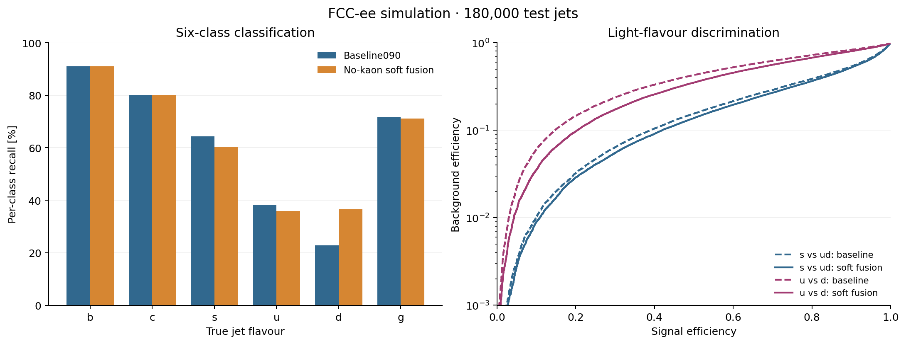

# FCC-ee Jet-Flavour Tagging

Transformer-based classification of six jet flavours in FCC-ee simulations, with a pairwise-attention specialist for light-flavour separation.

**Peijing Pang · University of Cambridge · MPhil in Data Intensive Science research project**

The model combines a six-class DeepJetTransformer-style baseline with an `s/u/d` specialist. Particle-pair geometry, momentum, charge and token-type features enter the specialist's attention logits. Soft fusion redistributes the baseline's light-flavour probability among `s`, `u` and `d`.

## Results

The saved comparison contains **180,000 simulated jets** in the class order `b, c, s, u, d, g`.

| Metric | Six-class baseline | Pair-bias soft fusion |
| --- | ---: | ---: |
| Overall accuracy | 61.281% | 62.476% |
| Macro-average recall | 61.353% | 62.527% |
| d-jet recall | 22.745% | 36.602% |
| s-vs-ud signal efficiency at 10% background efficiency | 38.95% | 41.98% |
| u-vs-d signal efficiency at 10% background efficiency | 14.72% | 20.43% |

The gain in d-jet recall accompanies lower s- and u-jet hard-label recall. Checkpoints were selected by validation loss, and feature variants were also compared on this test sample. These results therefore do not provide an independent test of feature-set selection. See [Method and evaluation](docs/method.md) for the protocol and interpretation.



## Installation

Use Python **3.11 or later**. The pinned environment uses Python **3.13.7**.

```bash
python -m venv .venv
source .venv/bin/activate
python -m pip install -r requirements.txt
python -m pip install --no-deps --no-build-isolation -e .
```

## Reproduce the result figures

```bash
python scripts/reproduce_results.py --output-dir outputs/results
```

The repository includes the final prediction arrays, so this command runs on a CPU without ROOT data or model checkpoints. It writes comparison figures, accuracy tables and fixed-background-efficiency working points.

| Notebook | Contents |
| --- | --- |
| [Final comparison](notebooks/01_final_comparison.ipynb) | Validate saved scores, compare flavour recall and evaluate light-flavour working points. |
| [Pair-feature ablation](notebooks/02_pair_feature_ablation.ipynb) | Compare the recorded feature-group studies and their trade-offs. |

## Model and training

The baseline uses charged and neutral particle-flow candidates, secondary vertices, V0 candidates and global jet variables. The final specialist uses the `no_kaon` pair-feature set: explicit kaon-pair features are excluded, while the token-level `baseline090` kaon-ID input is retained.

```text
P_light = P6(s) + P6(u) + P6(d)
P_fused(s/u/d) = P_light * P_UDS(s/u/d)
P_fused(b/c/g) = P6(b/c/g)
```

ROOT preprocessing, baseline training, specialist training and checkpoint evaluation are provided in `src/djt/` with command-line entry points in `scripts/`. See [Running the analysis](RUNNING.md) for the complete training and evaluation commands, and [Data specification](docs/data.md) for the input schema.

## Repository structure

```text
src/djt/       Models, ROOT preprocessing, training, evaluation and metrics
scripts/       Training, evaluation and result-reproduction commands
notebooks/     Final comparison and pair-feature analysis
results/       Saved prediction arrays and experiment summaries
assets/        Result figures
slurm/         GPU job examples
docs/          Method, data and scientific references
tests/         Model, preprocessing and result checks
```

## Development

```bash
python -m pip install -r requirements-dev.txt
python -m pytest -q
```

## References and acknowledgements

The baseline follows the DeepJetTransformer study by Blekman et al. and the DeepJetFCC implementation. The pairwise-attention design is inspired by Particle Transformer. See [References](docs/references.md), [Acknowledgements](docs/acknowledgements.md) and [Third-party notices](THIRD_PARTY_NOTICES.md) for scientific sources, code attribution and license scope.
